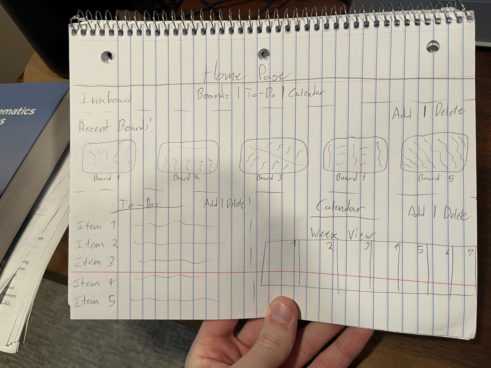
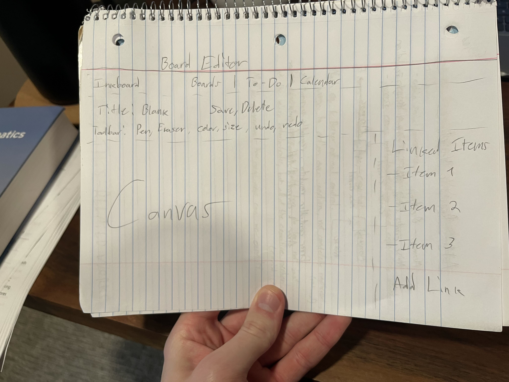

# Inkboard

Eldon Pouliot

---

## Part 1: What it is and who it's for

**What is it?** Inkboard is a personal whiteboard and organizer. You draw or write notes on a canvas with a pen, eraser and text tool, and they save to the server so you can reopen and keep editing them later. Next to the boards it has a to-do list and a calendar. Any board, to-do or event can be linked to any other one. For example, a "Lab 8 notes" board can be linked to the "Lab 8 due" event and the "finish Lab 8" to-do.

**Who uses it?** I came up with this idea mostly for me, but it can be for anybody who wants an easy way to keep notes or diagrams, or just quickly sketch out an idea with more than just words than by typing. When they open it, they want to:
- jot down or sketch an idea quickly and know it's saved
- find an old board again
- see what's due and what's left to do
- jump from a task or deadline to the notes that go with it

---

## Part 2: What people can do

- ★ Create a new whiteboard and draw on it (pen color/size, eraser)
- ★ Save a board and reopen it later exactly as it was
- ★ See all saved boards in a list, and rename or delete them
- Add typed text boxes to a board
- Add, check off, edit and delete to-do items (with an optional due date)
- Add, edit and delete calendar events, and view them in a month view
- Link a board, to-do or event to another one, and click a link to jump to it
- Search boards, to-dos and events by title

★ = can't work without, so I build these first.

---

## Part 3: Pages

| Page | What's on it | What the user can do |
|---|---|---|
| **Home / Dashboard** (`/`) | Recent boards, today's to-dos, the next 5 events | Click into anything, start a new board, check off a to-do |
| **Boards list** (`/boards.html`) | Every board as a card (title, last edited) | Open, rename, delete, create a new one, search |
| **Board editor** (`/board.html?id=…`) | Canvas, toolbar (pen, eraser, color, size, text, undo, save), title field, "Linked items" side panel | Draw, type, save, rename, add or remove links |
| **To-do list** (`/todos.html`) | List of to-dos with checkboxes and due dates, plus an add form | Add, edit, check off, delete, filter done/not done, open links |
| **Calendar** (`/calendar.html`) | Month grid with events (and to-dos that have due dates) | Click a day to add an event, click an event to edit, delete, or link it |

**Sketches:**

---

## Part 4: Data

All collections use `{ timestamps: true }` so they get `createdAt` and `updatedAt`.

**boards**
- `title` (String, **required**, default "Untitled")
- `strokes` (array of **embedded** stroke objects)
  - `tool` (String, enum: `pen`, `eraser`)
  - `color` (String, like `#222222`)
  - `width` (Number, 1 to 50)
  - `points` (array of `[Number, Number]`, the x,y pairs)
- `texts` (array of **embedded** text boxes)
  - `x` (Number), `y` (Number), `text` (String, required), `size` (Number), `color` (String)

**todos**
- `title` (String, **required**)
- `done` (Boolean, default false)
- `dueDate` (Date, optional)
- `notes` (String)

**events**
- `title` (String, **required**)
- `start` (Date, **required**)
- `end` (Date)
- `allDay` (Boolean, default false)
- `description` (String)

**links** (one link connects two items, and it shows up on both of them)
- `fromType` (String, **required**, enum: `board`, `todo`, `event`)
- `fromId` (ObjectId, **required**)
- `toType` (String, **required**, same enum)
- `toId` (ObjectId, **required**)

**Nesting:** strokes and text boxes live inside a board, like reviews inside a product in Lab 6. Links are their own collection because they connect two different collections and have to be found from either side.

---

## Part 5: Routes

**Hello / test**
- `GET /api/hello` returns `{ message: "hello from Inkboard" }`

**Boards**
- `GET /api/boards` returns all boards (title and dates only, no strokes, so the list loads fast)
- `GET /api/boards/:id` returns one full board with strokes and texts
- `POST /api/boards` creates a board
- `PUT /api/boards/:id` updates a board (title, strokes, texts). Used by Save.
- `DELETE /api/boards/:id` deletes a board and its links

**To-dos**
- `GET /api/todos` returns all to-dos (`?done=false` to filter)
- `GET /api/todos/:id` returns one to-do
- `POST /api/todos` creates a to-do
- `PUT /api/todos/:id` updates a to-do (including checking it off)
- `DELETE /api/todos/:id` deletes a to-do and its links

**Events**
- `GET /api/events?from=…&to=…` returns events in a date range (one month of the calendar)
- `GET /api/events/:id` returns one event
- `POST /api/events` creates an event
- `PUT /api/events/:id` updates an event
- `DELETE /api/events/:id` deletes an event and its links

**Links**
- `GET /api/links?type=board&id=…` returns every item linked to that item (from either side), with titles
- `POST /api/links` creates a link
- `DELETE /api/links/:id` removes a link

**Search (extra)**
- `GET /api/search?q=…` returns boards, to-dos and events whose title matches

---

## Part 6: Tools

- **HTML Canvas API**, to draw strokes and redraw a saved board from its points
  https://developer.mozilla.org/en-US/docs/Web/API/Canvas_API/Tutorial
- **Pointer Events**, so one set of handlers works for mouse, touch and stylus
  https://developer.mozilla.org/en-US/docs/Web/API/Pointer_events
- **Express body size limit.** `express.json()` only accepts 100kb by default and a board with a lot of drawing is bigger than that. I'll use `express.json({ limit: '5mb' })`.
  https://expressjs.com/en/api.html#express.json
- **Mongoose subdocuments**, for strokes inside boards
  https://mongoosejs.com/docs/subdocs.html
- **Calendar view (optional).** I'll build a simple month grid myself first. If that takes too long, I'll use FullCalendar.
  https://fullcalendar.io/docs/initialize-globals

---

## Part 7: Plan by week

**Week 7:** Hello version deployed on my server. One page (`index.html`) calls `GET /api/hello` and shows the message, served by Express and connected to MongoDB. The repo is on GitHub with this README.

**Week 8:** Boards working end to end. I can draw with the pen (color and size), click Save, reload the page, and see the same drawing. The boards list page shows all boards with create, rename and delete. All 5 board routes work (I can test them with curl or Thunder Client).

**Week 9:** To-dos and calendar. The to-do page has full CRUD and check-off. The calendar page shows a month grid with events, and I can add, edit and delete events. Eraser, undo and text boxes are on the board editor.

**Week 10:** Linking and dashboard. Each board, to-do and event page has a "Linked items" panel where I can add a link, remove a link, or click through to the other item. Deleting an item also deletes its links. The home dashboard shows recent boards, open to-dos and upcoming events.

**Finals week:** Search, cleanup and polish. Error messages for bad input (missing title, bad id), a consistent look across pages, it works on a phone or tablet with touch, a final deploy, and the README updated with how to run it.

---

## Part 8: The hard part

**Most worried about:** the whiteboard itself. That means getting smooth drawing with mouse and touch, saving strokes as data (not just a picture), and redrawing them correctly when a board is loaded. Big boards could also get slow or hit the request size limit.

**Backup plan:**
1. Save the canvas as a PNG with `canvas.toDataURL()` and store that string on the board instead of strokes. I lose undo and editable strokes, but drawing, saving and reopening still work.
2. If linking runs long, I'll cut it down to linking a board to a to-do or event only, shown on the board page.
3. If the calendar grid runs long, I'll show events as a list sorted by date instead of a month view.

---

## Part 9: Repo

Repo created on GitHub, with this plan as `README.md`. The link is at the top of this doc.
